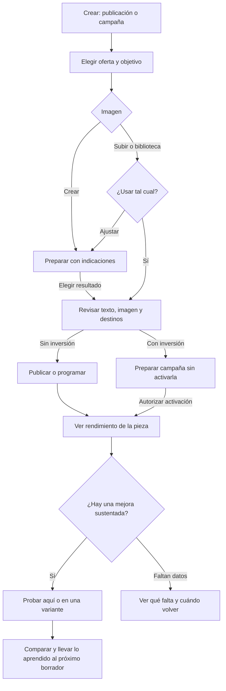

# Publicidad guiada: crear, publicar, medir y mejorar desde el panel

## Contexto
Para cualquier administrador autorizado, incluso sin experiencia en publicidad. La precisión no se negocia: la referencia, el sabor, la presentación, las cantidades del combo y la condición del obsequio salen del catálogo y de lo que se revisó. Las indicaciones visuales son por pieza. Leer, preparar un borrador, publicar y autorizar gasto son decisiones distintas.

## Así se usará el panel

Ejemplo: «Conseguir consultas por WhatsApp sobre Dúo Cacao con muestra de vainilla». La persona ve la **condición exacta del regalo** al elegir, al ajustar su foto y al aprobar. Más tarde encuentra **conversaciones y costo por conversación**, si están disponibles, no una cifra de ventas inventada. Si prueba otro texto, queda registrado qué cambió, dónde y si alcanzó el criterio que se acordó antes de probarlo.

## Implementación

### 1. Elegir una oferta real y conservar exactamente lo revisado

- Añadir `lib/business/social-offers.mjs`: no hay una proyección publicitaria de catálogo. `generation/sources` busca archivos, solo incluye productos con foto local y no resuelve combos; `snapshotCatalogItem` es para pedidos e incorpora costos. Reutilizar los registros de `Store`, `inventoryAvailability`/`stockAvailable` de `lib/inventory.mjs` y `hash` de `lib/business/commands.mjs`, no crear otro catálogo.
- Añadir `GET /api/admin/social/offers` en `app/api/admin/social/offers/route.js` con `authorize`, `json`, `errorResponse`, `runtime='nodejs'`. Dos lecturas sin efectos: (a) `query`, `kind` opcional (`product|gift|combo`), `offset` y `limit`, por defecto 12, máximo 30; responder `{offers,nextOffset}`; (b) `kind` e `id` solos para la ficha exacta. Rechazar parámetros extra/repetidos. Buscar nombre, presentación, sabor y SKU sin distinguir mayúsculas; paginar con orden estable por título y luego ID. Usar parámetros SQL y escape de comodines como `listSocialGenerationSources`, para SQLite y PostgreSQL. Cargar juntos los componentes de los resultados por sus IDs, no descargar el catálogo completo al navegador ni consultar por cada componente.
- Mapear producto y obsequio a `records.kind='products'` verificando `productType` (ausente significa `product`); combo a `records.kind='combos'`. Lista: tipo, ID, título, presentación, sabor, SKU **solo para desambiguar en el panel**, precio en pesos COP enteros, miniatura local segura o sin foto y estado de disponibilidad. La ficha devuelve además `factsHash` y los datos comerciales: nombre y variante, marca si existe, descripción, `productInfo` de etiqueta, precio propio, `conditions` del combo, referencia de foto local y `components` en el orden de `items` con ID, nombre, presentación, sabor, foto local y cantidad exacta. No sumar precios de componentes ni intercambiar sabor/presentación por similitud. La cantidad incluida en la oferta es publicable; inventario, reservas y costos no lo son.
- Para nuevas selecciones usar referencias no archivadas, habilitadas (`orderable ?? status==='published'`), con componentes normales válidos en combos/obsequios. Un obsequio con precio cero es válido; un valor desconocido no es cero. Mostrar agotados como no seleccionables y existencias desconocidas como «Consultar disponibilidad» sin prometer stock. Para un producto/combo **más** obsequio, comprobar disponibilidad para una unidad de la promoción agregando las cantidades de componentes compartidos; nunca reservar ni descontar stock. Una ficha previamente guardada que ya no sea elegible sigue visible como histórica con una indicación para cambiarla.
- Contrato nuevo de borrador en `saveSocialCampaign`: `offerRef: null | { primary: {kind,id,factsHash}, gift: null | {id,factsHash,condition} }`. `factsHash` es la huella de la ficha comercial mostrada, incluidos componentes y foto; excluir SKU, cantidades de stock y campos operativos. Solo admitir `gift` adicional si la principal es producto o combo y el ID es realmente un obsequio distinto. `condition` es texto del operador de hasta 500 caracteres; permitir vacío en borrador, no al crear la imagen contextual ni al aprobar. No inferir «gratis», descuentos, compra mínima o vigencia por el nombre o el tipo. Sin selección se conserva la posibilidad actual de una publicación de marca o un borrador con solo nombre.
- Resolver en servidor `resolveSocialOffer(store, offerRef)` en la transacción de guardado. El cliente **no** envía fotos arbitrarias, precios, composición, `offerSnapshot` ni `offerHash`. Si un ID cambió de tipo, desapareció o no coincide con los hechos vistos, responder 409 y conservar la edición local; ofrecer volver a leer la ficha y aceptar sus cambios o quitarla. Guardar en `social_campaigns.data` el selector y el `offerSnapshot` derivado `{primary,gift}` (regalo con su condición), más `offerHash=hash(offerSnapshot)` cuando haya oferta. En PATCH, omitir `offerRef` conserva la selección; `null` la quita. Sin migración SQL.
- Integrar `offerRef` en `normalizeSocialCampaignInput` y en la proyección de `duplicateCampaign`. En `campaignSpecification` incluir **solo** `offerHash` como dato nuevo de la spec si hay oferta; sin ella no añadir ni una clave `null`, para conservar hashes antiguos. `commitApproval` congela además el snapshot en `social_revisions.data.offerSnapshot`; el resumen aprobado lo lee ahí, nunca del catálogo vivo. Duplicar copia la referencia y el snapshot al nuevo borrador, no la aprobación ni las autorizaciones; si están desactualizados se pide actualizar. En `lib/business-backup.mjs` comprobar la forma y concordancia del snapshot con su hash cuando exista, sin exigir que un producto histórico siga activo ni reescribir revisiones antiguas.
- Usar una sola comprobación de oferta vigente en validación de borrador de `getSocialCampaign` (error de validación, no fallo de lectura), `proposal` de `lib/business/social-analysis.mjs`, `queueSocialBrowserPreflight` antes de preparar/validar y `approvalSnapshot` (también se ejecuta en el commit). Comparar la ficha revisada, condición y elegibilidad, no versiones de datos financieros no utilizados. No revalidar catálogo para ver, conciliar o pausar publicaciones ya aprobadas. En `lib/assistant/forms.mjs`, `offerRef` es un campo **humano de envío** de `campaign-draft`, no un campo proponible por Ali: validar forma acotada, conservarlo en los guardados asistidos a través de `normalizedProposalPayload`, y seguir rechazando parches del asistente para cambiarlo.

### 2. Preparar la imagen desde la información del negocio y el objetivo guardado

- En `lib/business/social-generation.mjs` añadir `getSocialGenerationBrief(store, {campaignId=null,baseAssetId=null,env=process.env}={})` y `buildSocialImagePrompt(brief, instructions, sources)`. Exponer `GET /api/admin/social/generation/brief` autenticado y `no-store`: devuelve `{campaignId,campaignVersion,briefHash,brief,baseAsset,automaticSources}` con hechos, finalidad visual y miniaturas; no envía nada, no crea trabajos, no expone rutas ni secretos. Con `campaignId`, exigir borrador editable (404 si no existe; 409 si ya no es editable o requiere revisar la oferta). No exigir cuenta Meta ni archivo previo para diseñar. Sin campaña es creación general de biblioteca. Con `baseAssetId` preparar la vista previa de ajuste de **ese archivo privado**; no asumir la última selección.
- Componer `brief` con una **lista permitida**, no con un volcado de la BD: identidad de vitrina de `store.settings()` (`brandName`, `tagline`, logo local); catálogo publicado al que pertenece la referencia; hechos comerciales de la oferta principal, obsequio, etiqueta, cantidades y condiciones; modalidad, redes/ubicaciones elegidas, `headline`, `caption`, tipo de destino y orientación creativa de `recommendationInstructions` si la hay. Incluir como contexto secundario los mensajes comerciales publicados de marca y el horario/cobertura de envío públicos, identificándolos como contexto general, no como condiciones de esta promoción. Para tráfico basta el dominio público del destino, nunca query/fragmento; para WhatsApp basta el canal, no un teléfono ni la conversación. Solo texto de vitrina apto para la pieza: no pasar métodos con números bancarios, contactos personales, clientes/pedidos, SKU interno, finanzas, stock exacto, credenciales, IDs de cuentas/píxeles o historial bruto de Meta. No enviar URLs de imágenes para que se descarguen. Mostrar al operador los datos que saldrán; puede corregir las fuentes o no enviarlas.
- El **objetivo de la campaña guardada** gobierna mensaje, composición y CTA. Mantener los cuatro valores de `SOCIAL_OBJECTIVE_CONFIG` y aplicar esta dirección concreta; no basta concatenar el enum al prompt:

  | `objective` | Dirección visual y acción buscada |
  |---|---|
  | `reach` | Nombre de marca y silueta/foto de la referencia reconocibles a primera vista; mensaje corto de descubrimiento, sin forzar compra. |
  | `engagement` | Un detalle real de la oferta y una pregunta breve sobre ese detalle que invite a comentar; no inventar variantes, concursos ni premios. |
  | `traffic` | Jerarquía hacia una sola acción: conocer los detalles en el sitio elegido; no dibujar un enlace/botón funcional, QR ni dominio inventado. |
  | `whatsapp` | Destacar oferta y condición, con invitación a consultar por WhatsApp; no fabricar número, conversación, botón funcional ni venta asegurada. |

  Si existe un `measurementConfig` guardado en la conexión (`updatedAt` presente), incluir **solo** su `objective` como meta global secundaria. Por ejemplo, negocio `sales` + campaña `whatsapp` orienta la consulta hacia el producto, no cambia la pieza a «comprar» ni crea un objetivo nuevo de Meta. Para Instagram orgánico no prometer un enlace clicable en el texto. Si faltan identidad extra, destino o foto, no inventarlos; dejar los requisitos de publicación al validador existente.
- Reutilizar `sourceBytes`, los controles `LOCAL_IMAGE`/`PUBLIC_IMAGE` y la lectura privada con verificación de archivo. Extender la lectura interna a la foto de un combo y al logo guardado, sin aceptar rutas, URLs, logos o combos arbitrarios en `input.sources`. En modo campaña elegir en orden: foto principal, del regalo adicional, fotos de los componentes de la principal y del obsequio en el orden registrado, y logo si queda un cupo. Eliminar duplicados por imagen local y mantener la correspondencia de cada foto con sus referencias; enviar hasta cuatro. Indicar exactamente cuáles se usarán. Un componente sin foto se conserva **por nombre y cantidad**: nunca redibujar un envase no documentado ni presentar la foto del combo como la del obsequio. Si no hay foto local del artículo, proponer diseño tipográfico sin simular su envase. Un archivo inseguro o perdido no se sustituye por una URL; volver a mostrar el contexto antes de consentir un cambio. La biblioteca conserva las fuentes `asset|product` manuales y el camino desde texto sin imágenes; los hechos de esas referencias incluirán sabor/presentación. En una campaña las fotos de identidad proceden de la selección, no de una búsqueda paralela de productos.
- **Ajuste por indicaciones, sin editor manual de recorte.** La imagen subida es la primera fuente explícita, no otra foto del catálogo: identificarla como «imagen a modificar» y reservar hasta tres lugares para las referencias automáticas sin duplicados. Los datos de catálogo prevalecen sobre envases, texto o regalos contradictorios de la base. Pedir «¿Qué quieres cambiar?» (p. ej. «aclara el fondo, conserva la etiqueta y la condición del regalo»), no reconstruir el formulario comercial. Abrirla o subirla no genera cargos ni reemplaza el original.
- Reutilizar la reserva/carga privada y `sourceBytes`. Una foto fija JPEG/PNG/WebP `ready` usa su derivado verificado. Si al procesar **el único impedimento es `IMAGE_GEOMETRY`**, ofrecer «Ajustar para publicar»: leer por ID el original privado con SHA/tamaño verificados y decodificarlo por completo con `sharp`, límites existentes de bytes/píxeles, un solo frame y tipo real coincidente; orientar, reducir a tamaño de referencia y quitar metadatos sin recortar el producto. El original no pasa a `ready` ni puede publicarse así. Servir una previsualización autenticada de esos mismos bytes de referencia. Archivo corrupto, animado, archivado, desaparecido o sin permiso no entra por esta vía; explicar cómo reemplazarlo. GIF/video mantienen su camino normal, no se ofrecen como una foto ajustable.
- En el prompt separar reglas fijas, hechos verificados, orientación comercial, correspondencia de fotos e indicaciones por pieza. Estas últimas dirigen estilo/encuadre, **no** pueden modificar identidad, etiquetas, precio, regalos, condiciones u objetivo. Mantener prohibición de claims médicos, curas, resultados garantizados y datos personales. No imprimir instrucciones internas ni atribuir la creación a una IA en la pieza. Admitir indicaciones vacías cuando el contexto del borrador ya identifica el encargo; en biblioteca sin borrador mantener las instrucciones requeridas. Respetar 4 000 caracteres de instrucciones y 12 000 de prompt final de `generateOpenAIImage`: priorizar reglas, identidad/variantes, composición, condiciones/advertencias, objetivo e instrucciones; después descripción, textos de apoyo y datos generales por bloques enteros. No cortar una condición, confundir una oferta por acortar ni enviar un JSON truncado. Si lo indispensable no cabe, explicar qué acortar antes de encolar; no hay cargo.
- Cambiar `POST /api/admin/social/generation`: conservar `requestId`, `configurationVersion`, `prompt`, formato, controles GIF y `sources`; añadir `campaignId`, `campaignVersion` (ambos `null` en biblioteca), `briefHash` y `baseAsset: null | {id,version,sha256}`. `baseAsset` es la base de ajuste consentida, no un `assetId` para publicar; el hash identifica los bytes de referencia mostrados. Para crear desde cero es `null`; para ajustar exigir indicaciones. En campaña `sources:[]`: el servidor completa las referencias del catálogo. Biblioteca conserva `{kind,id,version}` manuales, siempre cuatro fuentes como máximo incluida la base. Validar ID, acceso, versión, huella de hechos/fuentes, tipo y bytes en servidor. Incluir base, instrucciones, formato, fuentes y consentimiento en idempotencia. Antes de encolar comparar contexto/versión; en 409 mantener la edición y pedir revisar y consentir de nuevo. Resolver una repetición ya aceptada **antes** de releer datos mutables.
- Como ahora se enviarán datos del negocio, usar `consent.version:2` y mantener `cost`, `externalProcessing`, `noCustomerData`, `humanReview` expresamente `true`. Actualizar la biblioteca y sus fixtures en el mismo cambio del endpoint. En `social_generation_jobs.data` congelar el contexto exacto, fuentes, consentimiento e instrucciones; en `generationTurn`, componer desde esa foto congelada y verificar que actor/configuración, borrador, contexto y fuentes siguen válidos, también en `beforePost`. Si cambian antes de enviar, `blocked`, cero POST; un trabajo antiguo `queued` con consentimiento v1 no recibe contexto nuevo: bloquearlo sin envío y pedir nueva autorización. Conservar el tratamiento de `sending`/`uncertain`, sin reenvío facturable ni alteración de históricos.
- Mantener el proveedor real `generateOpenAIImage`, `/images/edits` con bytes cuando haya referencias, `/images/generations` si no; misma cola, originales, derivado y formatos. En el activo contextual conservar `generation.alignment={mode,objective,offerHash}` (`null` para oferta de marca), `briefHash` y huella del **prompt efectivo**, no el brief ni las instrucciones en texto claro fuera del trabajo privado. Conservar `aiDisclosure:true` y `reviewRequired:true`. En `buildSocialSpec`, bloquear una pieza con `alignment` que no corresponda a modalidad, objetivo u oferta actuales, incluso si se elige por la biblioteca/API. Archivos propios e históricos sin alineación declarada siguen disponibles para revisión manual; no atribuirles retrospectivamente hechos o un objetivo. Nada de esto crea entregas, publica ni activa gasto.
- En una variante registrar además la procedencia `baseAssetId` y hash de la base en el trabajo privado y en los metadatos internos del resultado. Crear **otro** activo; no mutar, archivar ni cambiar la selección del original. Aplicar al resultado contextual los mismos controles de oferta/objetivo, privacidad y divulgación. El ajuste no debe convertir una pieza en otra con procedencia «propia».

### 3. Hacer las tres decisiones desde el mismo borrador

- En `AdvertisingWorkspace.jsx` usar una entrada **Crear publicidad** (cabecera y vacío del listado), que abre el editor existente. En `AdvertisingCampaignEditor.jsx` reemplazar las dos listas de cinco pasos, instrucciones, índices de navegación/validación, `firstIncomplete`, foco de reapertura y guardas `step===…`: un único recorrido de tres pasos para `organic|paid`. Reutilizar `changeMode`, `selectConnection`, `changePlatforms`, `changeAsset`, `persist`, `resetAcceptance`, `Configuration` y `AssetPreview`; no crear un segundo editor ni duplicar validación de Meta. `Continuar`/`Anterior` navegan localmente sin guardar, generar ni publicar. `Guardar borrador` está disponible con nombre desde cualquier paso. Adaptar «Cómo usar Publicidad» al ciclo crear → publicar → medir → probar una mejora, manteniendo la gestión de conexiones en Configuración.
- **1 · Qué anunciar.** Ofrecer «Post sin inversión» / «Campaña pagada» y objetivo en lenguaje comercial. Selector buscable por tipo **Producto / Obsequio / Combo**, con alternativa «Publicación de marca, sin producto». Consultar el endpoint del paso 1 al abrir/buscar, con debounce de 250 ms y cancelación de respuestas obsoletas como en `AdvertisingGeneration`. Distinguir carga, sin coincidencias y error con reintento. Mostrar variantes por título + presentación + sabor, SKU o ID corto para homónimos; al elegir, tarjeta compacta con foto, precio COP, composición y condiciones. Solo producto/combo muestra **Añadir un obsequio**; filtrar por `gift`, exigir selección real y explicar para qué compra aplica. Mostrarlo separado del contenido normal del combo; quitarlo elimina su condición. Sugerir nombre interno editable a partir de título, variante y objetivo **solo si está vacío**; no reemplazar escritura del operador. Mantener cuenta/redes bajo un resumen editable, sin seleccionar cuentas ni autorizar nada por defecto. Poder preparar contenido aun sin cuenta.
- Implementar el selector una sola vez en `components/AdvertisingOfferPicker.jsx` para la oferta principal y para la lista restringida a obsequios. Si se reemplaza la referencia principal, retirar el obsequio adicional y su condición con aviso visible; nunca transferir una promoción a otra compra sin volver a elegirla. No vaciar el texto escrito por el usuario.
- **2 · Preparar contenido.** Oferta, obsequio, objetivo, texto y CTA visibles; URL/WhatsApp solo para el objetivo correspondiente. Dos caminos principales: **Crear imagen** o **Subir imagen**; **Elegir de biblioteca** como atajo. Al subir o elegir, presentar **Usar tal cual** y **Ajustar con indicaciones** sin guardar ni aplicar automáticamente. Reutilizar la carga real de `AssetsPanel` en un solo `AdvertisingAssetUpload` (reserva POST, PUT de bytes, cuota y límites actuales); refrescar el archivo concreto mientras se procesa. «Usar tal cual» requiere derivado `ready` y no llama al proveedor. «Ajustar» abre el mismo compositor con la base visible; mostrar original y variante lado a lado (en móvil, alternar con rótulos); **Usar la variante** o **Conservar original**. Si el original no es publicable, conservarlo como fuente sin seleccionarlo para publicar. No anidar formularios.
- **Crear imagen** trabaja con el borrador guardado, no con datos reescritos por el usuario. Si es nuevo o tiene cambios, la acción se llama «Guardar borrador y preparar imagen»: usar la cadena de guardado normal, incluido `assistant.submitAssisted`; en éxito pasar a `committed(result,{openImage:true})`. Conservar en `AdvertisingWorkspace` una continuación de un uso ligada al ID para que, tras el remontaje `new → id` y `applyDetail`, se abra **el paso 2 de ese registro**, antes de introducir indicaciones. Si ya está guardado, abrir directamente. Si falla el guardado, no abrir otra campaña ni solicitar generación. La única llamada de posible cargo es el botón explícito del creador.
- Para «Ajustar», esa misma continuación de un uso transporta `{campaignId,baseAssetId}`: guardar un borrador nuevo, cambiar de paso o elegir otro archivo no puede perder ni intercambiar la base. Una respuesta tardía jamás sobrescribe el texto, la selección ni una variante posterior. El consentimiento de cada ajuste muestra los datos y la foto que saldrán, el posible cargo y la revisión obligatoria.
- Reutilizar `AdvertisingGeneration` en biblioteca y en contexto con `campaignId`, `campaignVersion`, `baseAsset` y `onUseAsset(asset)` opcionales. Mostrar brief, miniaturas y «Indicaciones para esta imagen» (opcionales al crear con contexto, obligatorias al ajustar); PNG por defecto, GIF/tiempos en «Opciones de formato» para creación. Mostrar objetivo y acción visual; no pedir otra vez producto ni objetivo. Cambiar instrucciones, base, formato o contexto retira consentimiento y renueva clave de solicitud. Si el borrador cambió, guardar y recargar el contexto sin perder indicaciones. Separar el estado de edición, generación y carga; preservar campos al cambiar de paso, abortar lecturas al salir y evitar que el polling sobrescriba texto. Un trabajo en segundo plano no bloquea el panel indefinidamente.
- Extender `listSocialGenerations(store, actorId, {campaignId=null}={})` y el GET existente para filtrar **antes del límite de 30** por actor y, en editor, por campaña. Biblioteca sin filtro mantiene historial. Consultar solo al abrir el compositor; progreso cada 5 s mientras haya trabajo pendiente, pausado si la pestaña está oculta. `succeeded` con derivado `processing` aún no es utilizable. Una vez `ready`, mostrar el derivado real y **Usar esta imagen**: validar correspondencia actual y usar `changeAsset` con el DTO devuelto, incluso si el inventario paginado aún no se refrescó. No seleccionar automáticamente, no reemplazar un archivo por una respuesta tardía y no guardar ni aprobar por pulsar «Usar». Si la oferta/objetivo cambian, conservar el resultado en biblioteca pero señalar «Esta imagen corresponde a otra oferta u objetivo» e impedir usarlo como si estuviera alineado. Ante indisponibilidad de creación mostrar el motivo y ofrecer archivo/biblioteca sin perder el borrador.
- Completar `publicJob().asset` con `name`, `sha256` y solo la alineación comercial necesaria para esta decisión. Adaptar `changeAsset(value, selectedAsset)` para el resultado recién revisado y la carga propia; los dos llamadores actuales (selector de biblioteca y parche `assetId` de `useAssistantForm`) siguen resolviendo el ID en inventario. Conservar el DTO seleccionado para el preview mientras se actualiza inventario. En un cambio efectivo de archivo, pieza conocida como generada → `aiDisclosure:true` no revocable; para una pieza propia sin procedencia conocida pedir la declaración en revisión, sin heredar un «no» o un «sí» de la anterior.
- **3 · Revisar y publicar.** Resumen de la variante, regalo y condición, composición/precio, imagen real, texto/CTA, objetivo, cuenta, redes y ubicaciones; «Editar oferta» y «Editar contenido» vuelven al paso correspondiente. Orgánico: agenda opcional y horizonte; pagada: audiencia/ubicaciones, total en moneda de cuenta, fechas, zona y costo opcional. Agrupar segmentación detallada, identificadores y datos técnicos en desplegables; mostrar siempre pendientes, importe total y alcance de la acción. Ubicar aquí la búsqueda oficial de audiencia y preparación privada del navegador cuando procedan. Mantener intactos guardas, estimación ligada a `specHash`, derechos, advertencias, declaración de contenido, presupuesto y activación separada. Al retomar un borrador, abrir 1 si falta nombre/cuenta/redes o la oferta requiere atención; 2 si falta pieza, texto/destino requerido; en otro caso 3. La continuación explícita de crear imagen prevalece. Las aprobadas no muestran wizard: resumen congelado y operaciones actuales.
- **Lenguaje y accesibilidad.** En `AdvertisingGeneration`, `AdvertisingWorkspace` (intro, carga, tarjetas) y editor, usar «Crear imagen», «Preparando imagen», «Lista para revisar», «Vista previa de la pieza». Retirar de cabeceras, ayudas, botones, estados cotidianos, nombres accesibles y alt la promesa «con IA/OpenAI» o el nombre del modelo; no sustituirla por una falsa atribución humana. El consentimiento visible sigue identificando a **OpenAI** como destinatario de instrucciones, datos y fotos, costo variable sin tope, ausencia de datos personales, revisión y no publicación automática. En revisión final mantener la declaración real de procedencia/etiquetado que requiere la plataforma y el bloqueo de las vías que no la verifican. Reutilizar `AdvertisingWorkspace.module.css` para foco, controles táctiles ≥44 px y una columna en móvil; `aria-current="step"`, títulos enfocables, estados en vivo y errores accionables. No introducir un tema visual nuevo.
- **Una entrada, una acción siguiente.** Mantener las tres pestañas existentes con rótulos claros («Publicaciones y campañas», «Biblioteca», «Resultados»). En el inicio, las tarjetas de `CampaignRow` muestran nombre, miniatura/variante, tipo, objetivo, redes y estado: **Continuar borrador**, **Comprobar publicación** o **Ver rendimiento**, según corresponda. Explicar al elegir tipo: «Publicación: se muestra en tus redes sin comprar difusión» / «Campaña: elige a quién llegar y el máximo total que autorizas». No exigir configurar métricas para guardar. Errores junto al campo con una salida («Conectar cuenta», «Cambiar archivo», «Volver a revisar»); no esconder advertencias determinantes en «Avanzado», no ampliar permisos de administrador ni exigir conocer identificadores.
- **Dónde saldrá.** Mostrar «Página de Facebook» y «Cuenta profesional de Instagram» con sus nombres reales; se puede elegir una o ambas explícitamente. Para cada una: previsualización orientativa de la misma pieza y texto, Feed/Reels según formato y modalidad, «Disponible» o motivo + corrección. Comprobar compatibilidad antes de pagar por un ajuste y de aprobar: archivo, red, cuenta, permiso, método y etiquetado. Si aún no hay cuenta mostrar «Por comprobar», no un visto bueno. En la API v26 de este proyecto, foto con divulgación en Facebook o pieza con divulgación en pauta no puede publicarse por esa vía: ofrecer elegir expresamente otra vía que pueda verificar la etiqueta o un archivo compatible; nunca retirar la declaración ni cambiar cuenta, lugar o vía en segundo plano. WhatsApp es destino de consultas, no un tercer canal de publicación; no ofrecer Stories, Threads ni Messenger sin adaptador.
- **Tras confirmar.** Para orgánico, estado, enlace cuando exista y causa/acción por entrega Facebook/Instagram: una confirmada y otra incierta = «Publicación parcial», nunca «Publicada en ambas» ni reenviar la confirmada. En pauta, una entrega `meta_ads`, un conjunto, un anuncio y un presupuesto total: distinguir ubicaciones autorizadas de ubicaciones donde se observó distribución; no afirmar que cada red publicó o gastó. «Preparar sin activar» → autorización separada para **Activar con inversión**; «Programada», «En revisión de Meta» y «Activa» no son equivalentes. Mantener desde la misma ficha el paso a rendimiento y acceso a la evidencia de estado.

### 4. Resultados comprensibles de esta pieza, no un informe de toda la cuenta

- En `AdvertisingWorkspace` y `AdvertisingResults` el enlace **Ver rendimiento** conserva `tab=results` y el `record` exacto, incluidos recarga, Volver y acceso desde una recomendación. Con registro, primero su miniatura, oferta, objetivo, estado por destino y la pregunta **«¿Logró lo que buscabas?»**; mantener el análisis general de `MetaAccountAnalysis` y la configuración de `AdvertisingMeasurement` en la vista de cuenta, no como obstáculos antes del resultado. Sin registro, ofrecer elegir una publicación/campaña por nombre, no ingresar un ID. Resolver estados sin datos, en curso, cobertura parcial, fallo de lectura y datos obsoletos sin borrar la última lectura identificada. No mostrar otra campaña durante un cambio de ficha.
- Llevar la novedad a la lista principal, no obligar a buscarla: en la tarjeta del registro mostrar **«Mejora disponible · Ver propuesta»** si hay una propuesta vigente sin atender, **«Prueba en curso»** si está observándose o **«Ya hay una conclusión»** cuando termina. Enlazar directamente al bloque de esa ficha. Proyectar los estados de las campañas de la página en una lectura por lote, no un informe por fila. No mostrar una recomendación vencida como nueva ni añadir notificaciones externas.
- Reutilizar `GET /api/admin/social/results?campaignId=…`, `getSocialResults` y los agregados por entrega: una cifra principal según el objetivo (**clics al enlace**, **conversaciones**, **personas alcanzadas** o **interacciones**), período/red y última captura. En pauta, gasto real frente al total autorizado y costo por resultado solo si se puede calcular; en orgánico, cifras por red, sin sumar alcance ni mostrar gasto. En Instagram orgánico no estimar conversaciones/clics ausentes. Distinguir «0 reportado», «Sin dato» y «Aún es pronto»; si la última captura fue parcial mostrar la anterior completa con fecha y aviso. La previsión aprobada es referencia, no venta, dato observado ni garantía. Mostrar pedidos y gastos vinculados por el administrador separados de las métricas de Meta.
- Segundo bloque **«Qué probar ahora»**: una recomendación prioritaria y «Ver las demás» (máximo de cinco del motor actual). Cada tarjeta contesta **qué se observó, qué cambio probar y cómo sabremos si ayudó**; incluir red, período, referencia comparable y enlace a evidencia. Ejemplo: «Los clics por impresión quedaron por debajo de otras campañas comparables. Prueba otro texto sin cambiar el público ni el presupuesto. Mediremos si sube esa tasa sin subir el costo por resultado». Una hipótesis no es un diagnóstico de la imagen. Sin medición, priorizar **Completar medición**; sin muestra, explicar qué falta o cuándo volver; si no hay señal, **No hay un cambio justificado por ahora**. Los detalles de atribución, fuente, limitaciones y métricas completas siguen a un clic.
- Reutilizar las reglas y umbrales de `buildSocialRecommendations`, sin puntuación inventada, automatización de gasto ni otro motor. **Actualizar vista** relee datos locales; **Actualizar desde Meta** solicita captura; **Revisar mejoras** solicita evaluación local si procede. Abrir Resultados no hace ninguna de esas escrituras. Una recomendación obsoleta se puede leer, no aplicar: verificar frescura real (lecturas nuevas, capturas incompletas y revisión comercial), versión y `evidenceHash` en el servidor tanto al iniciar como al confirmar un cambio.
- Concretar esa garantía de lectura: hoy los GET de `app/api/admin/social/{results,campaigns/[id]}/route.js` llaman a `getSocialAnalysis`, que puede **encolar** al detectar obsolescencia. Usar allí `readSocialAnalysis` (la proyección existente sin efectos); dejar la actualización por cambios de medición/vínculos en su cola y el recálculo solicitado en la acción autenticada `analyze`. Mantener `asOf`, filtros y las advertencias; no crear trabajo por expandir la ficha, abrir ayuda ni consultar aprendizajes.

### 5. Aplicar una mejora: elegir el efecto antes de confirmar

- En `Recommendations`/`ResultActionDialog` ofrecer **Probar en una nueva publicación/campaña**, **Cambiar esta publicación/campaña** con los destinos/campos realmente compatibles, o **Descartar** con motivo. Mostrar qué quedará intacto y qué se verá en Meta. Con una publicación en dos redes no suponer que una edición cambia las dos; permitir «Cambiar solo Facebook» si esa entrega es elegible, o crear una variante con destinos explícitos. Para brechas de medición y costos, abrir la tarea concreta en la misma ficha, sin editar contenido ni atribuir un resultado comercial. Un cambio de horario pasado requiere una publicación nueva.
- **Nueva pieza.** Reutilizar `duplicate-from-recommendation` y `duplicateCampaign`: conservar oferta, pieza de referencia y texto **como punto de partida**, en vez de vaciar `caption`/`assetId`. Ir directamente al campo de la prueba, con «Actual» y «Propuesta»; `assertRecommendationApproval` debe exigir un cambio real del tipo acordado y su confirmación. Un destino/franja propuestos se explican; se elige fecha nueva. No heredar entregas, permisos, fechas, aprobación, autorizaciones de gasto ni vínculos financieros. `parentCampaignId`/`sourceRecommendationId` mantienen el vínculo. La tarjeta dice **Borrador preparado**, no «Publicado» ni «Mejoró». Una nueva publicación no transfiere comentarios, enlace ni métricas de la original.
- **La misma pieza en Meta.** El código actual implementa publicación inicial y controles de pausa/reanudación, no edición de texto o medio ya publicado. `saveSocialCampaign` es para borradores y `commitApproval` congela la aprobación. Crear un borrador de cambio con `applicationMode:same`, campaña, entrega, recomendación y versión efectiva de origen fijadas por el servidor; conservar esos campos en los guardados, no aceptarlos del cliente. Retomar la propuesta en el mismo compositor sin reabrir el original. No aparece como otra campaña publicada; no puede invocar `approve-organic`/`prepare-paid`, su equivalente asistido ni preflight de creación de otro anuncio. Solo editar la variable propuesta. Para convertirla en nueva publicación se requiere una elección explícita. La aprobación original y su previsión siguen accesibles tal como fueron.

  | Objeto y propuesta | Qué hará «Cambiar esta» y qué verificará |
  |---|---|
  | Facebook, post de Feed propio publicado por la app; otro texto | API: `POST /{page-post-id}` con `message` y lectura posterior del **mismo** ID, página, texto, adjunto y estado publicado. No sustituir imagen, no usar el ID de foto como ID de post. Si no consta que lo publicó esa app, el archivo cambió fuera del panel o falta permiso, no enviar. [Pages API: actualizar un post](https://developers.facebook.com/documentation/pages-api/posts.md). |
  | Instagram orgánico por API; texto o medio ya publicados | No prometer esa edición: el `POST` del medio documenta moderación de comentarios, no sustituir foto ni pie de foto. Ofrecer nueva versión vinculada y conservar enlace y resultados del original. [Instagram Media: Updating](https://developers.facebook.com/documentation/instagram-platform/reference/instagram-media#updating). |
  | Campaña pagada propia; nuevo texto o imagen | Con pauta **pausada** y vigente, preparar el creativo revisado y enlazarlo al **mismo anuncio** `POST /{ad-id}` con `creative:{creative_id}`. Conservar campaña, conjunto, anuncio, presupuesto, segmentación y fechas. Releer la relación anuncio→creativo, contenido y estado; Meta puede volver a revisarlo. No prometer conservar la interacción social del creativo anterior. Si estaba activa, proponer la pausa como acción separada; reanudar requiere confirmar de nuevo el saldo y fin vigentes, nunca automáticamente. [Ad](https://developers.facebook.com/documentation/ads-commerce/marketing-api/reference/adgroup/) · [SDK oficial v26: `Ad.api_update`](https://github.com/meta/facebook-python-business-sdk/blob/26.0.4/facebook_business/adobjects/ad.py#L250-L291). |
  | Pauta pausada; probar una ubicación ya autorizada | Acotar únicamente ubicaciones del mismo conjunto al subconjunto propuesto. Verificar el `targeting` observado y el efectivo, misma audiencia, campaña, anuncio, presupuesto y plazo; ninguna ampliación de alcance. Si no se acredita la selección exacta, bloquear y ofrecer una variante. [Ad Set](https://developers.facebook.com/documentation/ads-commerce/marketing-api/reference/ad-campaign) · [SDK v26: `AdSet.api_update`](https://github.com/meta/facebook-python-business-sdk/blob/26.0.4/facebook_business/adobjects/adset.py#L419). |
  | Vía navegador asistido | Usar solo la sesión y el método ya elegidos, con su bloqueo exclusivo. Implementar la edición desde el objeto existente cuando la superficie permita identificarlo, comparar lo actual, revisar el cambio, comprobar la divulgación y, al reabrir, leer el mismo ID y los valores aprobados. Nunca suplir una API con un navegador en silencio. Si esa cuenta/formato no expone esas pruebas, indicar el límite antes de enviar y ofrecer variante; tras un envío incierto, primero comprobar, no duplicar. |

- **Confirmación y ejecución.** Extender `socialRecommendationAction` con preparar el cambio en la misma entrega y confirmar su diferencia; ambos comandos idempotentes, autenticados para escritura y versionados. Mostrar antes/después, red afectada, evidencia vigente, efecto público, divulgación/derechos y, en pauta, total, saldo, fechas y necesidad de reanudar. Conservar una sola prueba abierta por propuesta/entrega. Cancelar un borrador de cambio no consume la recomendación ni escribe en Meta. No marcar la edición como aplicada por abrir el editor, consentir una imagen, aceptar un borrador o recibir un 200 del proveedor.
- Contrato de `POST /api/admin/social/recommendations/:id/actions`: `prepare-in-place` devuelve el ID del borrador de cambio (201); `confirm-in-place` toma su ID/versión, la entrega local, versión de la recomendación, hash de diferencia revisada, confirmaciones y `requestId`, y devuelve la operación pendiente (202), nunca un «publicado». Repetir la misma solicitud devuelve el mismo resultado. La recomendación conserva `suggested` con referencia a la propuesta local en preparación; pasa a `applied` por esta vía **al comprobar el efecto remoto**. `duplicate-from-recommendation` conserva su significado existente de «usada en un borrador nuevo». Para ambos modos exigir un cambio de texto cuando la prueba es de texto, no aceptar solo otro archivo como hoy permite `assertRecommendationApproval`; abrir/abandonar no cuenta como una prueba.
- Journal existente `social_operations`, pasos de modificación por entrega y solicitud, sin reutilizar `publish`/`create_ad` ni crear otra entrega. Registrar el estado realmente leído, hash de base y propuesta, revisión original, identidad remota, actor, consentimiento y límite de campos. Fijar los IDs en el servidor. El worker revalida permisos, oferta/activo, configuración, derechos y estado justo antes de enviar, registra `beforeSend` y verifica por lectura después. Preparación de un creativo en subpasos con identificador único de la operación: recuperar por evidencia, jamás generar dos por un acuse perdido. Identidad distinta, deriva externa o divulgación no verificable bloquean; acuse perdido = **Por comprobar**, solo conciliación por lectura y sin alternativa automática. Las pausas de seguridad existentes permanecen posibles.
- Al confirmar la lectura, avanzar atómicamente en `social_deliveries.data` la referencia a la operación de contenido efectiva; conservar objeto remoto, instantánea anterior y vínculo con la prueba. Resolver la especificación efectiva **por entrega** desde la revisión inicial + cambios confirmados, no mutar `social_revisions`, `campaign.assetId`, presupuestos ni pronósticos históricos para hacer coincidir el worker. Usar esa misma resolución en `social-api-jobs`/`social-jobs`, inspección, controles de reanudación, custodia de activos, sincronización, resultados y análisis. Distinguir `specHash` original de la autorización de cambio; validar esta última y las fechas actuales en su propia rama, no eximirla de guardas ni exigir que una publicación pasada vuelva a tener inicio futuro. Actualizar validación de respaldo/restauración de referencias, hashes y propuestas: una restauración queda bloqueada para escritura remota hasta la reconciliación, nunca repite un cambio.

### 6. Aprender de cada prueba y reutilizar el hallazgo

- En Resultados, **«Qué aprendimos»** muestra la secuencia propuesta → borrador → cambio publicado/confirmado → observación → conclusión, enlazada al original y la variante o a las dos versiones de la misma entrega. Recuperar el historial completo y paginado de `social_recommendations` y sus pruebas, no solo los cinco `ruleKey` de la evaluación vigente. Cada ficha: qué se cambió (antes/después), objetivo/red/oferta, fechas y exposición, métrica anterior/nueva y criterio predefinido, tamaño/cobertura, conclusión y motivo. `improved` = «Mejoró según este criterio»; `not_improved` = «No mejoró según este criterio»; `inconclusive` = «No se puede concluir». Antes del cierre: **Aún estamos midiendo** con el horizonte esperado. «Descartada» no quiere decir «no funcionó».
- Para una **pieza nueva**, conservar `evaluateSocialRecommendation` y su evaluación padre/hija al completar la observación. Verificar que la variable sugerida realmente cambió, oferta/objetivo, red, definición/atribución, alcance, ventanas y presupuestos son comparables; respetar el cambio de ubicación si esa era la prueba. Si cambian también oferta, público o inversión, registrar el intento y explicar por qué no es evidencia aislada. No contar dos veces la misma prueba ni usar una hipótesis de la cuenta como una evaluación real de esta publicación.
- Para la **misma pieza**, registrar instante o intervalo de transición verificado, IDs de capturas previas, períodos y criterio **antes** de aplicar; no crear una hija ficticia para usar el comparador. En pauta contrastar dos ventanas completas de igual duración, elegibles para el criterio, no solapadas, misma zona/atribución/unidad y gasto comparable. Excluir día mixto, pausa/revisión y retraso de reporte; contar el después solo con entrega efectiva. Comparar tasas mediante sus numeradores y denominadores exactos; no sumar alcance ni restar dos acumulados de por vida. Si el post orgánico solo ofrece `lifetime`, o faltan base comparable, muestra, tiempo o separación de versiones, enseñar el total de la pieza y **No se puede aislar el efecto del cambio**. Avisarlo ya al elegir «Cambiar esta». No contaminar los futuros comparables con capturas mixtas ni reescribir lo aprobado.
- Añadir una lectura autenticada `GET /api/admin/social/learnings` para consultar por `campaignId` (historial de la ficha) o por contexto de borrador (oferta, modo, objetivo y red), orden estable y cursor, sin escrituras. Reusar los resultados persistidos de la evaluación y del journal, no inferir tendencias desde texto libre. Desde **Qué anunciar** mostrar, si corresponde, un hallazgo breve del tipo «En la prueba anterior el texto B consiguió más consultas al mismo costo» o «El nuevo fondo no alcanzó el criterio», con período y enlace. **Usar esta idea** propone *solo* la orientación pertinente y editable; sin coincidencia de oferta/condición o sin conclusión, no sugerir que algo funciona. No copiar presupuesto, audiencia, identificadores, datos de clientes, métricas brutas ni activar generación/publicación; el administrador decide. El historial sin datos primero enseña cómo iniciar una prueba, no recomendaciones de relleno.

## Anclas críticas

- `lib/store.mjs`, `Store.settings` y `Store.publicData`: la identidad comercial es de vitrina; `getBusinessSettings` es configuración contable. Usar proyecciones concretas, no enviar ninguno de los documentos completos.
- `lib/business/social-spec.mjs`, `campaignSpecification` / `buildSocialSpec`: hash de autorización y restricción real de divulgación de Meta v26; una imagen preparada no garantiza que el canal pueda publicarla.
- `lib/business/social-generation.mjs`, `sourceBytes` / `generationTurn.beforePost`: conservar la comprobación de bytes y la barrera durable anterior al único envío facturable.
- `components/AdvertisingCampaignEditor.jsx`, `applyDetail`, `hydrateCommittedDraft`, `save`: el editor se remonta por `campaignId`; no perder el paso ni las decisiones humanas en la navegación canónica.
- Antes de editar componentes o rutas, leer las guías instaladas de Next 16.4.3 `node_modules/next/dist/docs/01-app/01-getting-started/{05-server-and-client-components,15-route-handlers}.md`. Solo DTOs serializables cruzan al cliente.
- La carga privada actual no ofrece un GET individual de metadatos para seguimiento en el editor. Exponer `GET /api/admin/social/assets/:id` autenticado con el DTO seguro de `getSocialAsset`; consultar por el ID devuelto al subir, no depender de que la foto entre en la primera página del inventario. No exponer rutas de disco, bytes sin validar ni snapshots internos en los DTO de la biblioteca/creador.
- Entrega de documentación: actualizar `README.md` («Publicidad orgánica y pauta de Facebook/Instagram») y la ayuda contextual `AdvertisingGuide` con el ejemplo completo, los dos significados de aplicar una mejora y los límites de medición. No presentar contratos de prueba como evidencia de publicación o rendimiento real.

## Verificación

Desde la raíz con Node 24 y las dependencias del lockfile:

1. **Oferta y autorización.** Ampliar `tests/social-campaign-contract.mjs`/`tests/social-spec.test.mjs` con dos referencias homónimas de distinto sabor y un combo con cantidades. Seleccionar combo + obsequio a 0 COP con condición: recargar conserva IDs, variantes, cantidades, precio manual y condición. Sin condición se puede guardar, no aprobar. Cambiar un componente, precio o condición después de revisar impide autorizar la vieja versión; duplicar no altera la aprobada. Un archivo contextual para `traffic` no se autoriza en una campaña `whatsapp`. Una campaña histórica sin oferta conserva su hash; comprobar también que un guardado asistido conserva la elección humana.
2. **Lo que llega al proveedor.** Extender `tests/social-generation.test.mjs` usando su `transport` inyectado, fotos locales distintas y respuesta PNG válida de `sharp`, no una llamada de pago. Ejemplo: marca «Nutrición Norte», combo «Dúo» con `2 × Cacao 500 g`, obsequio «Muestra vainilla 30 g» bajo «Solo con Dúo», indicación «fondo azul, sin texto adicional». Verificar en el multipart real marca, cantidades/condición, instrucción, correspondencia SHA de cada imagen y dirección específica para los cuatro objetivos, incluso `sales` global + `whatsapp` local. No deben salir otra variante, teléfono, stock, costo, secreto o URL externa. Cubrir ausencia de foto (instrucción tipográfica), falta de consentimiento, cambio antes del POST, fuente manipulada y replay. Ejecutar worker y procesamiento: derivado decodificable `ready`, alineación correcta, sin entregas ni gasto. Una respuesta incierta nunca causa un segundo POST. Extender también el subcaso `human campaign disclosure survives canonical revision, diff, payload hash and the original draft handler` de `tests/assistant-actions-contract.mjs` con el selector humano. Comando: `node --test tests/social-spec.test.mjs tests/social-campaign.test.mjs tests/social-generation.test.mjs tests/advertising-migration.test.mjs tests/assistant-actions.test.mjs`.
3. **Interacción real.** Adaptar `tests/e2e/advertising.spec.mjs` (hoy recorre cinco pasos) y añadir «publicidad guiada: oferta y pieza en el mismo borrador». Con `advertisingFixture` crear variantes/obsequio y combo mediante APIs reales; comprobar búsqueda por sabor, foco/teclado, selección y regalo sin duplicar en la composición. Pasar a contenido y volver conserva el texto sin escrituras. Guardar para abrir creación desde `new` debe mantener paso 2, ID correcto y CTA de objetivo; no genera al abrir. Cargar un PNG real en el editor → esperar derivado visible → usar → guardar/recargar → misma imagen y oferta. En orgánico no hay presupuesto; al pasar a pagada sí, sin activación ni entrega. Verificar alternativa cuando el servicio de imagen no está configurado, botón no facturable sin consentimiento, accesibilidad del copy y ausencia de desbordamiento en los dos tamaños.
4. **Entorno de navegador.** Usar el fixture descartable de `README.md` («Pruebas y reproducibilidad»): aplicación compilada con los cambios, scheduler y volúmenes privados compartidos, Chromium, `E2E_BASE_URL` HTTPS de localhost, `TEST_DATABASE_URL` terminada en `/allnutrition_test`, `TEST_ALLOW_DATABASE_RESET=allnutrition_test` y TLS `TEST_DB_SSL`/`TEST_DB_CA_CERT_FILE` del fixture. Solo en esa base, `node tests/e2e/setup.mjs`. Ejecutar una vez `E2E_ALLOW_SELF_SIGNED=1 npm run test:e2e -- tests/e2e/advertising.spec.mjs --project=desktop --project=mobile` sin excluir los casos de Resultados. Usar transportes de prueba para efectos externos, las rutas y componentes reales del panel para el recorrido. No usar staging persistente, hacer un envío facturable ni activar anuncios reales para comprobar la UI.
5. **Probar el enlace creador → borrador, no solo la carga propia.** En una instancia descartable aislada del fixture anterior, compartir BD, claves de prueba y directorios de medios entre web y runner, con el scheduler ordinario detenido para que no reclame el trabajo. Configurar la credencial sintética mediante `saveAssistantSettings` y el `verify` de la fixture de `tests/social-generation.test.mjs`. Desde el navegador real, preparar la imagen, autorizar **esa** solicitud y observar el 202 y su ID. En el runner invocar `await processSocialGenerationTurn(store,{env,transport})` con el transporte local de esa prueba y `await processSocialAssetTurn(store,{env})`; no interceptar las rutas de la app. Tras el polling, comprobar que el derivado se decodifica, `assetId` sigue sin cambiar, y solo **Usar esta imagen** + **Guardar borrador** persiste exactamente `job.asset.id`. Recargar: misma oferta, mismo derivado, estado `draft`, ninguna entrega. Si se cambia el objetivo antes de «Usar», el resultado viejo sigue en biblioteca y no se aplica. Esta prueba verifica integración y selección, no la calidad artística de un proveedor real.
6. **Subir lista o ajustar.** En `tests/social-generation.test.mjs` y la fixture de navegador, usar una foto lista y otra vertical 9:16 válida que no se pueda publicar como imagen de Feed. La primera permite «Usar tal cual» con cero solicitudes de creación; la segunda solo como base de ajuste, no como pieza aprobable. Comprobar que el primer archivo enviado corresponde a la base vista, sin metadatos privados; la oferta/obsequio y el objetivo siguen en el encargo. El original mantiene su SHA, el resultado tiene otro ID, se pueden comparar y solo la elección explícita sustituye la imagen del borrador. Archivo dañado, falta de permiso o cambio de fuente entre revisión y envío no hacen POST al proveedor.
7. **Entrega real frente a promesa.** Ampliar `tests/social-meta-publishing.test.mjs`, los contratos de `social-api-jobs` y los de `social-browser-jobs` con el proveedor controlado existente. Cubrir Facebook+Instagram con una entrega incierta y otra confirmada; edición de mensaje FB conserva post y adjunto (Instagram API explica por qué solo admite variante); CTA/creativo pagado conserva IDs de campaña/conjunto/anuncio, fechas, monto y pausa; segmentación se acota solo como se confirmó. Verificar ID ajeno, pieza etiquetada sin soporte, consentimiento caducado, modificación externa y acuse perdido: ninguna segunda escritura, falsa confirmación, activación ni copia automática. Releer la ficha y preparar la reanudación con el nuevo creativo, no contra el viejo. Restaurar el journal no reenvía. Verificar la vía navegador contra su superficie semántica con lectura tras reabrir; para anunciar soporte en una cuenta real se necesita una prueba expresamente autorizada en activos de prueba, sin confundirla con el ensayo local ni autorizar inversión.
8. **Rendimiento y aprendizaje.** En `tests/social-improvements-model.test.mjs` y `tests/social-improvements-contract.mjs` cubrir: KPI real por objetivo; cero frente a no disponible; lectura parcial posterior; recomendación vigente frente a obsoleta; abrir no encola; duplicar no toca padre; preparar/cancelar cambio no lo aplica; confirmar dos veces no lo duplica. Probar las tres conclusiones con datos compatibles, criterios congelados y gastos comparables. Fechas solapadas, pausas, cambio simultáneo de público, `lifetime` orgánico y captura tardía nunca producen una mejora ficticia. La siguiente oferta igual puede recuperar un ensayo evaluado aunque ya no sea una de las cinco propuestas actuales; otra variante/regalo/objetivo no lo hereda. Comandos focalizados adicionales: `node --test tests/social-meta-publishing.test.mjs tests/social-api-jobs.test.mjs tests/social-browser-jobs.test.mjs tests/social-media-backup.test.mjs tests/social-improvements-model.test.mjs tests/social-improvements.test.mjs`.
9. **Prueba de uso de principio a fin.** Añadir al mismo Playwright los recorridos de «Resultados → Probar aquí», «Crear variante» y «Qué aprendimos → Usar esta idea», con métricas, lecturas y operaciones persistidas en el entorno de prueba. Comprobar el CTA correcto después de recargar/volver y que nada se publica al consultar. Aceptación de usabilidad en escritorio y móvil: entregar a una persona que no conoce Meta un encargo con dos sabores homónimos y un obsequio condicionado. Sin ayuda técnica debe poder distinguir post/campaña, recuperar el borrador, elegir o ajustar la foto correcta, identificar dónde saldrá y si hay gasto, encontrar el KPI relevante, explicar qué cambiaba la propuesta y decir si la prueba mejoró, no mejoró o aún no se sabe. Registrar dónde duda y corregir los obstáculos antes de dar por sencilla la experiencia.
